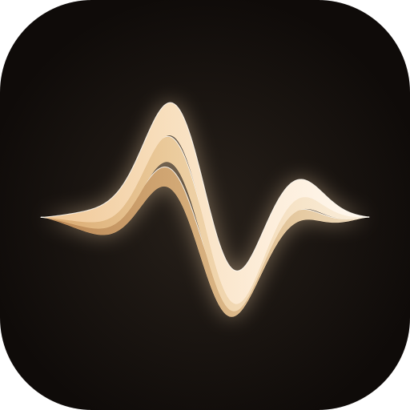
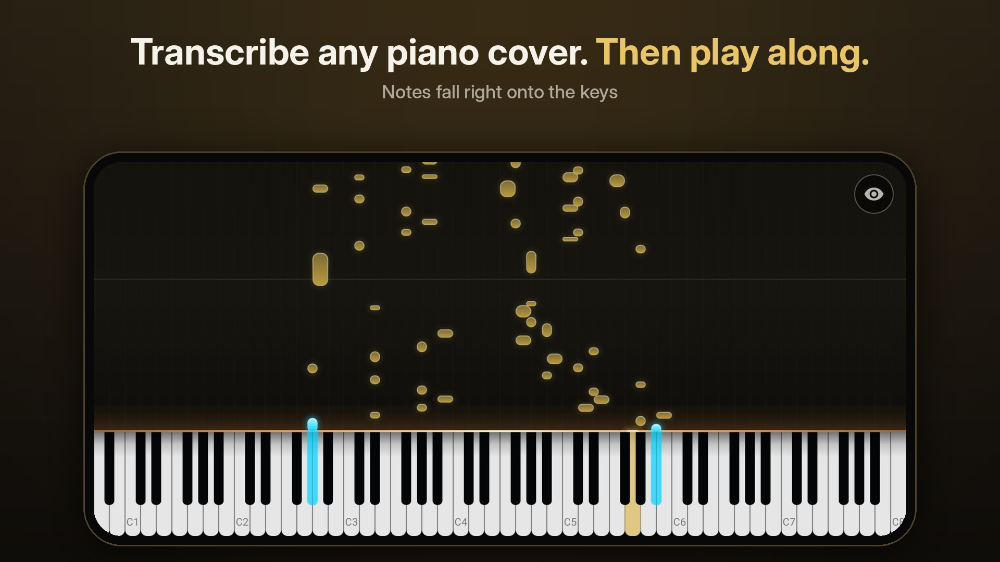
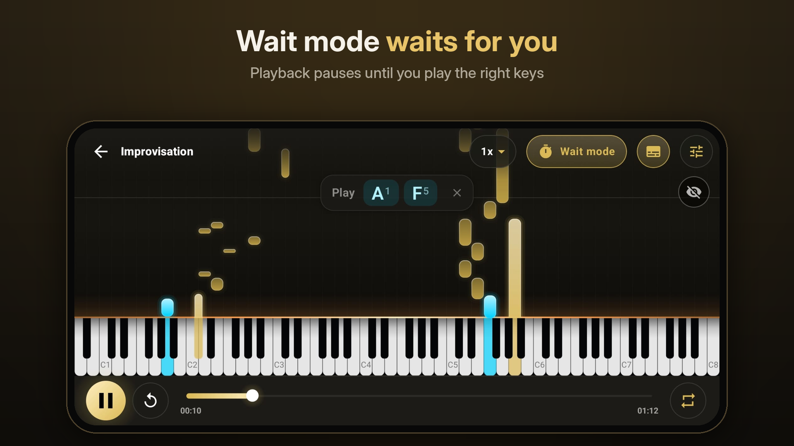
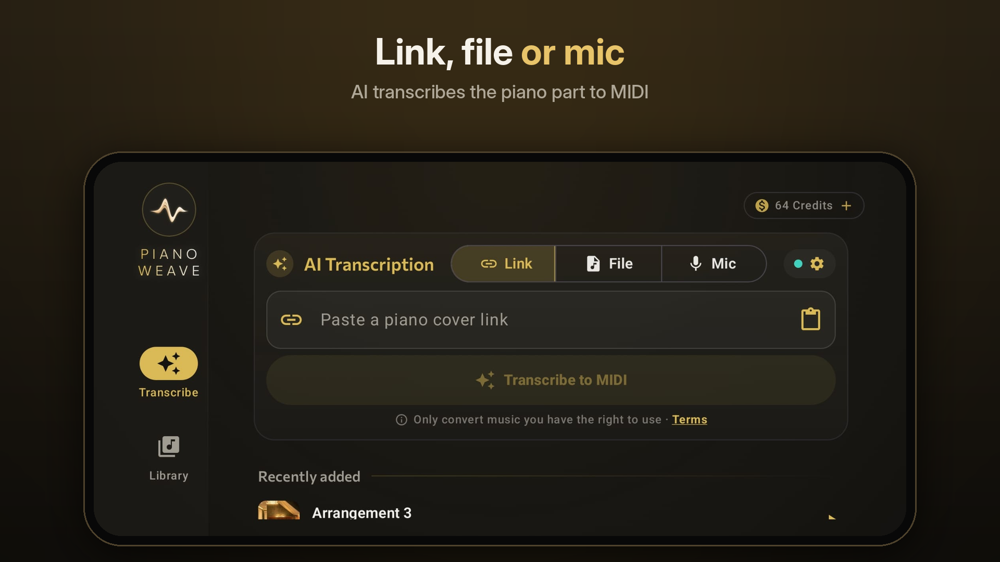
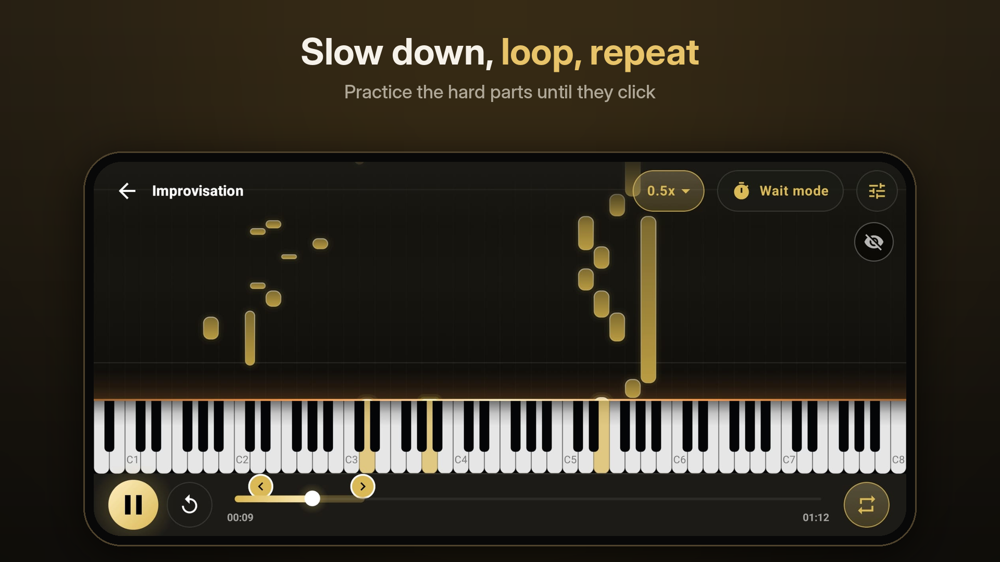
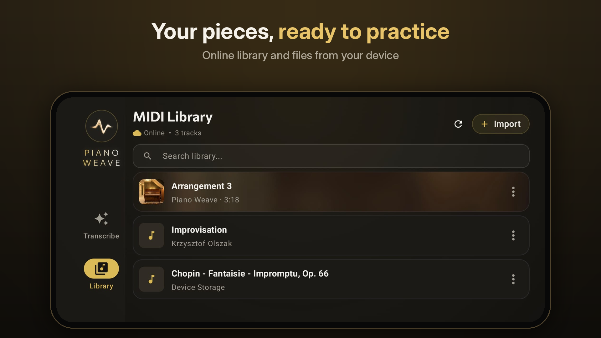
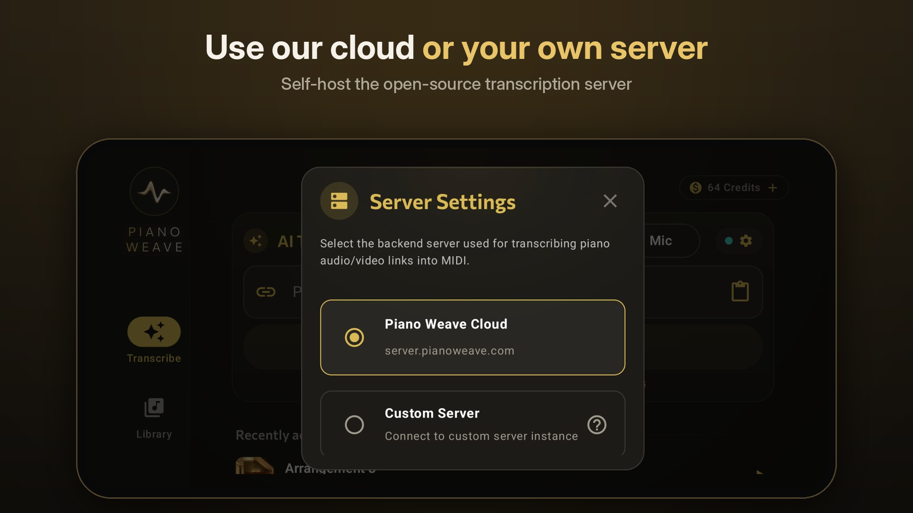

<p align="center">
  
</p>

<h1 align="center">Piano Weave</h1>

<p align="center">
  <b>Upgrade your piano learning experience with high-fidelity practice tools.</b><br>
  Piano Weave transcribes piano performances from online videos into interactive practice sessions with an ultra-pro piano roll and a high-quality Grand Piano audio engine.
</p>

<p align="center">
  <a href="#-features">Features</a> •
  <a href="#-community--support">Community & Support</a> •
  <a href="#-screenshots">Screenshots</a> •
  <a href="#-setup">Setup</a> •
  <a href="#-key-modules">Key Modules</a> •
  <a href="#license">License</a>
</p>

---

## 📱 Screenshots

<table width="100%">
  <tr>
    <th width="50%" align="center">Piano Weave</th>
    <th width="50%" align="center">Wait Mode</th>
  </tr>
  <tr>
    <td width="50%" align="center">
      
    </td>
    <td width="50%" align="center">
      
    </td>
  </tr>
  <tr>
    <th width="50%" align="center">AI Transcription</th>
    <th width="50%" align="center">Practice</th>
  </tr>
  <tr>
    <td width="50%" align="center">
      
    </td>
    <td width="50%" align="center">
      
    </td>
  </tr>
  <tr>
    <th width="50%" align="center">MIDI Library</th>
    <th width="50%" align="center">Server Settings</th>
  </tr>
  <tr>
    <td width="50%" align="center">
      
    </td>
    <td width="50%" align="center">
      
    </td>
  </tr>
</table>

## ✨ Features

* **AI Transcription:** Turns the piano part of a video link (e.g. YouTube), an audio/video file or a microphone recording into MIDI, using a FastAPI backend. Vocals and other instruments are left out, so the result is the piano part, not a full arrangement; piano covers give the best results.
* **Ultra-Pro Piano Roll:** Practice with a high-fidelity interactive roll featuring A/B looping, speed control, and transposition.
* **Grand Piano Sound:** Powered by FluidSynth and high-quality SoundFonts for a rich, realistic acoustic piano experience.
* **Wait Mode:** Pauses at each note until you play it, listening to a connected MIDI keyboard or, without one, to your acoustic piano through the microphone. With a keyboard the rest of the song plays along; with the microphone the song stays silent so the phone isn't heard as your playing.
* **MIDI Keyboards:** USB and virtual MIDI keyboards connect automatically. Their notes play through the app's piano sound, which can be turned off for keyboards with their own speakers.
* **Adaptive UI:** Optimized for both landscape (tablet/practice mode) and portrait (browsing mode) orientations, with many selectable color themes.
* **Cloud Persistence & Sync:** Google Drive integration and cloud account support for seamless backup and synchronization of your saved MIDI songs and practice sessions.

## 💬 Community & Support

<p align="center">
  <a href="https://discord.gg/vzMyRZewmb">
    
  </a>
  <a href="https://ko-fi.com/Y3G527Q9PN">
    
  </a>
</p>

## 🛠️ Setup

### Transcription server

This app requires the [Piano Transcription Server](https://github.com/Virtover/piano-transcription-server) running locally or on a server.

### Configuration

1. Copy `app/src/main/assets/config/config.example.txt` to `app/src/main/assets/config/config.txt`.
2. Set your `DEFAULT_API_BASE_URL` in the config file (e.g., `http://10.0.2.2:8000/` for a local emulator).
3. Set `WEB_CLIENT_ID` to your Google OAuth "Web application" client ID, and optionally `DISCORD_URL` to show a Discord button in app settings.

The official server is the only server that ever receives the user's Google token. Custom servers chosen in the
app are always used anonymously and without in-app purchases.

### Account deletion page

`docs/delete_account.html` (served by GitHub Pages) lets users delete their server account and their Drive cloud library.
The production server URL and the Web client ID are set in `docs/config.js`.
Keep them in sync with `DEFAULT_API_BASE_URL` and `WEB_CLIENT_ID` in a release `config.txt`.

For the page to work:

* the Web client must list `https://virtover.github.io` under **Authorized JavaScript origins** and be in the same
  Google Cloud project as the Android client (Drive's app folder is per project);
* its client ID must be in the server's `GOOGLE_OAUTH_CLIENT_IDS`;
* the server must allow CORS requests from `https://virtover.github.io` (`DELETE /api/account` with an `Authorization` header).

### Requirements

* Android Studio (latest stable) or the Android command-line tools
* JDK 17+
* Android SDK Platform 37
* Android NDK `30.0.16248370` (pinned in `app/build.gradle.kts`)
* CMake `3.22.1`

Android Studio installs the SDK, NDK and CMake on demand. From the command line (Windows):

```powershell
& "$env:LOCALAPPDATA\Android\Sdk\cmdline-tools\latest\bin\sdkmanager.bat" "platforms;android-37" "ndk;30.0.16248370" "cmake;3.22.1"
```

### Build

Open the project in Android Studio and build the `:app` module.

For a debug build from the command line:

```bash
./gradlew assembleDebug
```

On Windows:

```powershell
.\gradlew assembleDebug
```

Debug builds do not need a keystore. They are signed with the default Android debug key.

All dependencies resolve from Maven Central, Google Maven, and the bundled `local-maven/` folder (see below). No extra steps are required after cloning.

### Release build

Release builds are signed with a dedicated upload keystore for Google Play. If `keystore.properties` is missing (for example, on a fresh clone), release signing is skipped and only debug builds are available.

Create a local `keystore.properties` file in the project root:

```properties
storeFile=C:/Users/YourName/.android/pianoweave-upload.jks
storePassword=YOUR_KEYSTORE_PASSWORD
keyAlias=pianoweave
keyPassword=YOUR_KEY_PASSWORD
```

The keystore itself should be stored outside the repository. Keep both the keystore and its passwords secure and backed up.

The release build uses the `release` signing configuration defined in `app/build.gradle.kts`.

To generate a signed Android App Bundle for Google Play:

```bash
./gradlew bundleRelease
```

On Windows:

```powershell
.\gradlew bundleRelease
```

The resulting bundle is located at:

```text
app/build/outputs/bundle/release/app-release.aab
```

Keep the upload keystore safe. It is required for future release uploads to Google Play.

## 🚀 Key Modules

* **`audio`:** Real-time FluidSynth integration for grand piano synthesis, plus microphone note detection for wait mode.
* **`midi`:** Binary MIDI parsing, the song library and hardware input management.
* **`api`:** Retrofit-based communication with the transcription backend.
* **`auth`, `billing`, `cloud`:** Google sign-in, Play Billing credits and Google Drive sync.
* **`ui`:** Modern Jetpack Compose implementation of the practicing dashboard.

## License

Piano Weave is licensed under the [PolyForm Noncommercial License](LICENSE).

Copyright (c) 2026 Krzysztof Olszak

The software may be used, modified, and distributed for noncommercial purposes subject to the terms of the license.

Commercial use is not permitted without prior permission from the copyright holder. For the full terms, see the LICENSE file.

### Third-party software

* **[FluidSynth](https://github.com/FluidSynth/fluidsynth)** is licensed under LGPL-2.1 and is dynamically linked.
* **[fluidsynth-kmp](https://github.com/kotlinds/fluidsynth-kmp)** (Kotlin wrapper) is licensed under Apache-2.0. The modified build in `local-maven/` is built from [this fork](https://github.com/Virtover/fluidsynth-kmp/tree/fix-16kb-alignment), and the changes are limited to linker flags and the NDK version.
* The bundled SoundFont and ML model have their own licenses. See the files in `app/src/main/assets/`.